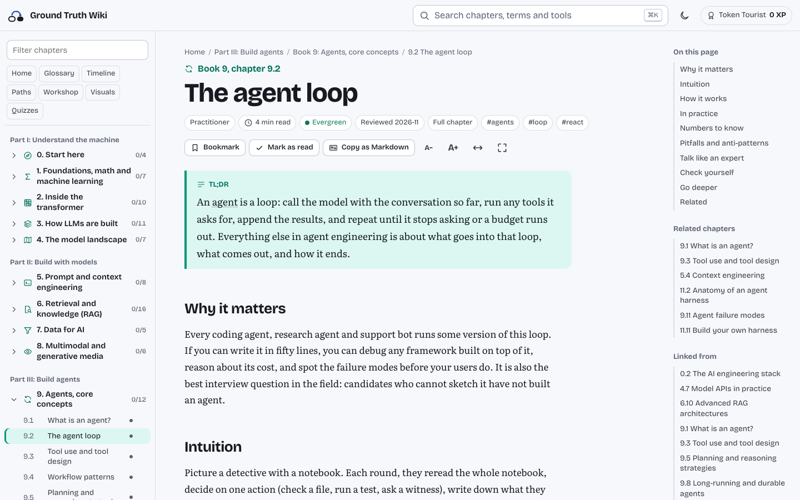

# Ground Truth Wiki

**An open, community-reviewed course, reference and playground for AI engineering.** Every chapter explains how modern AI systems are built, evaluated, secured and run, with interactive visuals, quizzes and sources you can check, and anyone can improve it with their own coding agent.

[](https://github.com/ground-truth-wiki/ground-truth/actions/workflows/ci.yml)
[](LICENSE-CONTENT)
[](LICENSE)



**Read it:** the live site opens soon. Until then, run it locally (below).

## What's inside

<!-- stats: generated by npm run stats -- --write; do not edit by hand -->
- **472 chapters** in 23 books and 6 parts, from linear algebra to agent protocols, evals and the frontier
- **553 visuals**, 398 of them interactive: steppers, explorers, calculators, sequence players, trees and more
- **703 quiz questions** with explanations, plus a boss quiz per book
- **1,965 glossary terms**, linked automatically on first use
- **204 timeline events**, 9 learning paths, 14 cheat sheets and 18 comparison matrices
- **8 playgrounds, 6 calculators and 7 decision wizards**
<!-- /stats -->

Every chapter has a TL;DR, the intuition, the mechanics, practice, numbers to know, pitfalls, how experts talk about it, a quiz, and where to go deeper. Fast-moving facts carry dates, and every chapter is reviewed on a schedule.

## Contribute

**With a coding agent** (Claude Code, Codex, Cursor or similar): sign in once with `gh auth login`, then paste this prompt and finish the last sentence:

```text
Contribute to Ground Truth Wiki: github.com/ground-truth-wiki/ground-truth. Read AGENTS.md first and follow it exactly. What I want to contribute: …
```

Your agent checks for duplicates, writes the change, runs the checks, and shows you everything before it opens a pull request in your name.

**Without one:** [share a playbook](https://github.com/ground-truth-wiki/ground-truth/issues/new?template=share-a-playbook.yml) from your own work, [report a problem](https://github.com/ground-truth-wiki/ground-truth/issues/new?template=report-a-problem.yml) on a page, or join the [discussions](https://github.com/ground-truth-wiki/ground-truth/discussions).

[CONTRIBUTING.md](CONTRIBUTING.md) explains it all step by step, for people who have never used Git.

## The rulebook in brief

Every claim has a checkable source. Facts are accurate and dated, and pages are reviewed on schedule. Contested topics show every side. Contributors disclose conflicts of interest. Pages explain and never sell. Case studies protect the people in them. A named human stands behind every change, and AI never approves. Everyone who contributes is credited. The content stays open under CC BY-SA 4.0, forever. The full text is in [GOVERNANCE.md](GOVERNANCE.md).

## Run it locally

You need [Node.js](https://nodejs.org) 20 or newer.

```sh
git clone https://github.com/ground-truth-wiki/ground-truth.git
cd ground-truth
npm install
npm run dev        # http://localhost:8080, rebuilds on every change
```

| Command | What it does |
|---|---|
| `npm run build` | Builds `dist/ground-truth.html`: the whole site in one file that works offline and contacts no server |
| `npm run build:site` | Builds the published site into `dist/site/`: the app, one page per chapter, the sitemap and `llms.txt` ([docs/DEPLOY.md](docs/DEPLOY.md)) |
| `npm run validate` | Checks every chapter, data file and link; errors name the file and line |
| `npm run search -- <terms>` | Finds existing chapters and glossary terms |
| `npm run new -- chapter <id> --book <n> --title "…"` | Starts a new chapter from the template |
| `npm run freshness` | Lists chapters due for review |
| `npm run roundtrip` | Proves the build still matches the original, apart from approved changes |

## How it is built

| Path | What lives there |
|---|---|
| [`content/`](content) | One Markdown file per chapter, in a folder per book |
| [`data/`](data) | Glossary terms, quiz questions, timeline, learning paths, matrices, cheat sheets and tools, as JSON |
| [`engine/`](engine) | The interactive engine: one script, one stylesheet and the page shell ([map](engine/README.md)) |
| [`scripts/`](scripts) | Build, validation, search and scaffolding, in plain Node.js with no framework |
| [`schemas/`](schemas), [`templates/`](templates) | What every file must contain, and where to start a new one |
| [`docs/`](docs) | The [coverage map](docs/COVERAGE_MAP.md), the [visual language](docs/VISUAL_LANGUAGE.md), the [design](docs/DESIGN.md) and the [migration notes](docs/migration/MIGRATION_NOTES.md) |
| [`source/`](source) | The original single-file book and its editorial rules, kept unchanged |

The site has no server, no accounts, no cookies and no analytics. Your reading progress stays in your browser.

## Credits

Ground Truth Wiki grew out of *The AI Engineer’s Bible*, version 2.0.0, a single-file book started by [@7oaker](https://github.com/7oaker) and kept unchanged in [`source/`](source). Every page names the people who shaped it.

It is built with [marked](https://marked.js.org), [highlight.js](https://highlightjs.org), [MathJax](https://www.mathjax.org) and [Mermaid](https://mermaid.js.org), and set in Bricolage Grotesque, Literata and JetBrains Mono (SIL Open Font License), all self-hosted.

## License

Content and data ([`content/`](content), [`data/`](data)) are licensed under [CC BY-SA 4.0](LICENSE-CONTENT). The engine, scripts and everything else are licensed under [MIT](LICENSE). Everyone in the project follows the [code of conduct](CODE_OF_CONDUCT.md).
